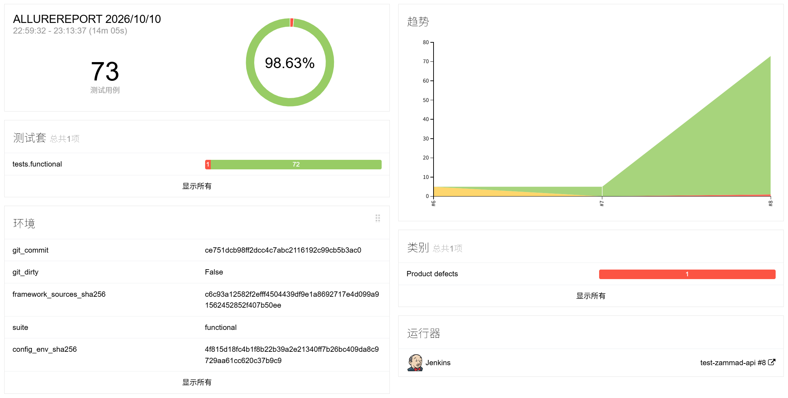
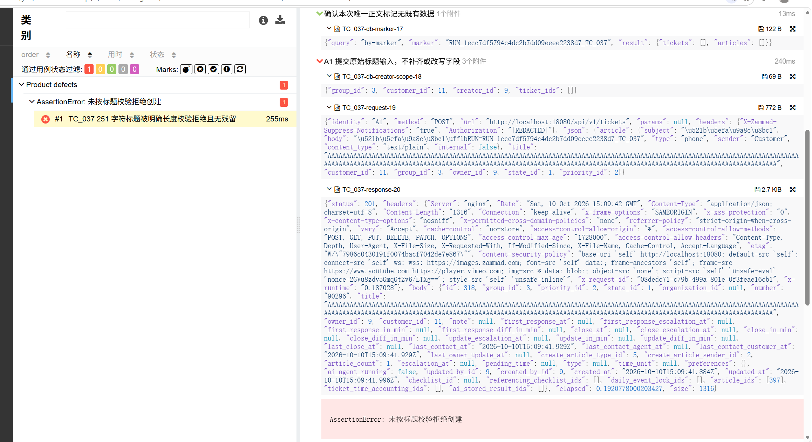

# Zammad 接口自动化测试

## 项目简介

基于 Python 和 pytest 的 Zammad 接口自动化测试项目，围绕 Zammad `7.2.0-0011` 的工单全生命周期、用户角色权限、业务配置和搜索功能，提供 **73 条业务功能用例**。通过独立身份发起请求，结合 API 回读、参数化只读数据库查询和资源清理核查，验证功能行为、权限边界与数据一致性，并将关键过程记录为脱敏的 Allure 证据。

## 技术栈

| 技术 | 用途 |
|---|---|
| Python 3.13.13 | 测试代码与辅助工具；当前本地环境为 Windows x64 |
| pytest | 用例组织、fixture 插件、标记筛选和结果统计 |
| Requests | 独立 Session 的 HTTP 请求及原始响应封装 |
| Psycopg 3 | PostgreSQL 参数化只读查询与持久化结果核验 |
| PyYAML | 场景数据和非敏感配置加载 |
| Allure | 测试步骤、执行结果和脱敏证据展示 |
| Jenkins | 提供 Windows agent 流水线配置，与本地共用运行入口 |

Python 依赖版本固定在 [requirements.txt](requirements.txt)，pytest 和 Ruff 配置见 [pyproject.toml](pyproject.toml)。

## 测试范围

| 业务模块 | 用例数量 | 核验重点 |
|---|---:|---|
| 工单创建 | 14 | 必填项、标题边界、身份与客户关联、失败无残留 |
| 工单处理与分派 | 15 | 负责人、转组、更新权限、非法更新回滚、挂起时间 |
| 消息、附件与备注 | 10 | 消息作者、可见性、附件内容与访问控制、备注修改保护 |
| 用户基础 | 4 | 用户创建、重复保护、局部更新、不存在用户读取 |
| 用户权限 | 4 | 提权保护、精确组授权、撤权后的新会话访问控制 |
| 角色管理 | 4 | 精确权限、名称校验、重名处理、客户越权保护 |
| 工单模板 | 4 | 模板创建、名称校验、局部更新、删除权限 |
| 文本模块 | 4 | 详情读取、备注长度边界、内部正文访问控制 |
| 宏配置与执行 | 4 | 动作与适用组、局部更新、管理权限、跨组批量操作原子性 |
| 列表与搜索 | 10 | 筛选集合、分页、客户隔离、查询无副作用、不存在详情 |
| **合计** | **73** | |

详细 TC 编号和断言见 [功能用例源码](tests/functional/)，输入与预期见 [场景数据](data/cases/)。[原始测试用例 Excel](docs/Zammad_工单创建测试用例.xlsx) 用于需求追溯，运行时由 YAML 场景数据驱动。

`pilot` 包含其中 5 条 P0 试点用例，属于上述 73 条的子集。另有 [离线框架检查](tests/framework/)，用于验证数据库封装和 fixture 插件，不计入业务用例数量。性能和并发专项尚未实现。

### 执行结果展示

以下为 **2026-10-10** 的 Jenkins 历史构建报告（构建 **#8**，代码版本 `ce751dc`）：共执行 **73 条**功能用例，**72 条通过、1 条失败**，通过率 **98.63%**，耗时 **14 分 05 秒**。



### 失败用例分析：TC_037 标题长度边界

下图为同一次 Jenkins **#8** 构建中的 TC_037 失败详情。用例提交 **251 个字符**的标题，预期返回标题长度校验错误（4xx）并拒绝创建；实际接口返回 **201**，创建的标题被截断为 **250 个字符**，因此触发“未按标题校验拒绝创建”的断言失败。后续 API 回读确认标题长度为 250，收尾时已清理本次创建的工单和文章。

核对部署的 Zammad `7.2.0-0011` 源码后，确认其[长度处理逻辑](https://github.com/zammad/zammad/blob/7.2.0/app/models/application_model/checks_attribute_values_and_length.rb#L39)会在保存前截断超长字符串。该结果反映用例预期与该版本实现的差异；截图中的 `Product defects` 分类不等于已确认的产品缺陷，验收预期仍需结合业务需求确定。



### 代表性用例：跨组批量操作原子性

- **业务场景**：通过一次请求，对分属两个组的工单执行仅适用于其中一组的宏。
- **核验方法**：检查响应为 422 且明确指向宏适用组限制，通过 API 回读和只读数据库比较两张工单及文章的前后快照，确认失败后没有发生部分修改。
- **源码入口**：[TC_190：跨适用组批量执行宏](tests/functional/test_macros.py#L74)。

## 框架设计

测试按“业务场景 → fixture 插件装配 → API 请求 → 响应及持久化核验 → 资源收尾与证据检查”的流程组织，各层分别负责场景、环境、请求、断言和运行管理。

- **身份隔离**：被测身份与维护身份使用独立 HTTP Session；权限场景由指定被测身份发起请求，维护身份负责数据准备、授权回读和清理。
- **API 与 DB 核验**：业务接口保留原始响应供断言，结合 API 回读和只读数据库证据检查持久化结果。`Queries` 提供统一查询入口，业务 SQL 和查询逻辑按模块维护，需要数据库核验的用例分别使用独立连接和短只读事务。
- **资源生命周期**：fixture 插件在整轮环境锁内管理前置、执行和收尾，通过 API 准备与清理本轮资源。写入结果未知、归属不明或清理失败时保留资源清单；角色创建场景按既定策略停用隔离后保留。
- **证据记录**：请求、响应、数据库核查和清理结果即时脱敏记录到 Allure；用例共享整轮证据预算，保存失败或容量超限时显式报告缺证。
- **运行编排**：`conftest.py` 集中注册 fixture 插件，`tools.run` 统一处理本地与 Jenkins 的执行入口、结果目录和运行元数据。HTTP 请求不自动重试写入，未解决残留会阻止后续业务执行。

## 项目结构

```text
test-Zammad/
├── api/                    # 按业务对象封装接口调用
├── clients/                # 身份对象与独立 HTTP Session
├── assertions/             # 共用业务断言与快照比较
├── fixtures/               # 业务前置、资源准备和清理
│   └── plugins/            # pytest fixture、身份配置及生命周期编排
├── db/
│   ├── config.py           # 只读数据库配置加载与校验
│   ├── base.py             # 共用只读会话、结果转换和查询工具
│   ├── queries.py          # 统一查询入口与业务方法委托
│   └── sql/                # 按业务模块维护固定 SQL 和查询逻辑
├── reporting/              # 整轮与用例证据记录
├── support/                # 配置校验、凭据脱敏、环境锁和资源清单
├── tools/                  # 运行入口、配置检查、元数据和搜索基线工具
├── tests/
│   ├── functional/         # 73 条业务功能用例
│   └── framework/          # 不访问被测环境的框架检查
├── data/
│   ├── cases/              # 业务场景输入与预期
│   └── baseline/           # 长期搜索基线定义
├── assets/                 # README 展示图片
├── config/                 # 配置示例，本地环境配置由 Git 忽略
├── docs/                   # 仓库保留的原始测试用例文件
├── artifacts/              # 本地执行产物，由 Git 忽略
├── conftest.py             # pytest 插件注册
├── pyproject.toml          # pytest 与 Ruff 配置
├── requirements.txt        # 固定版本的 Python 依赖
└── Jenkinsfile             # 手动触发的 Windows agent 流水线
```
